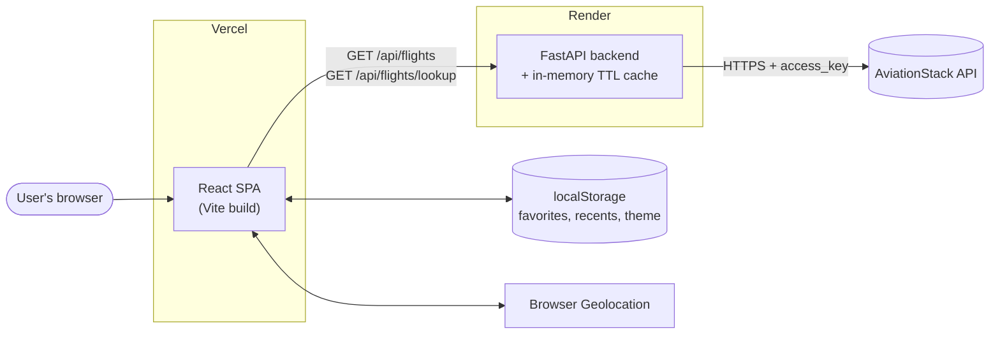
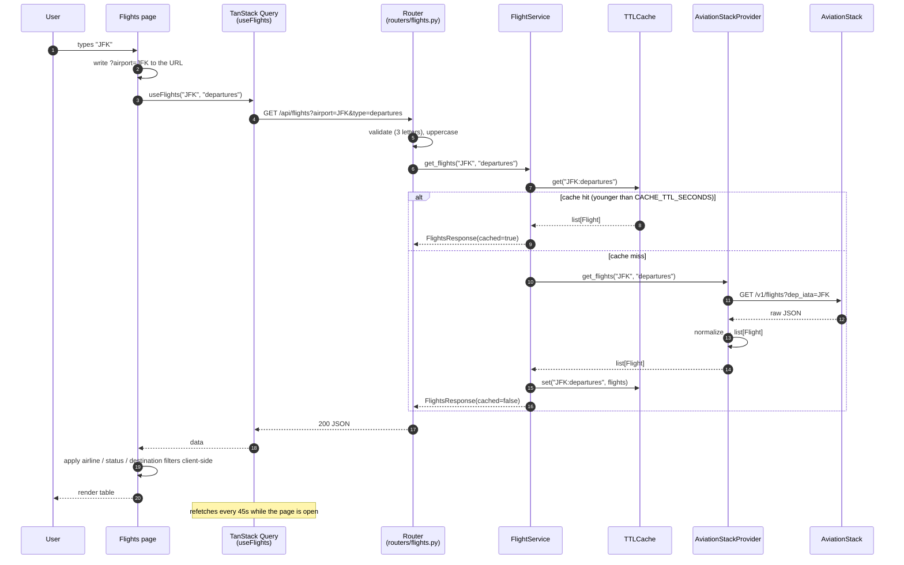
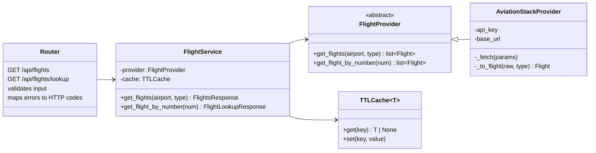
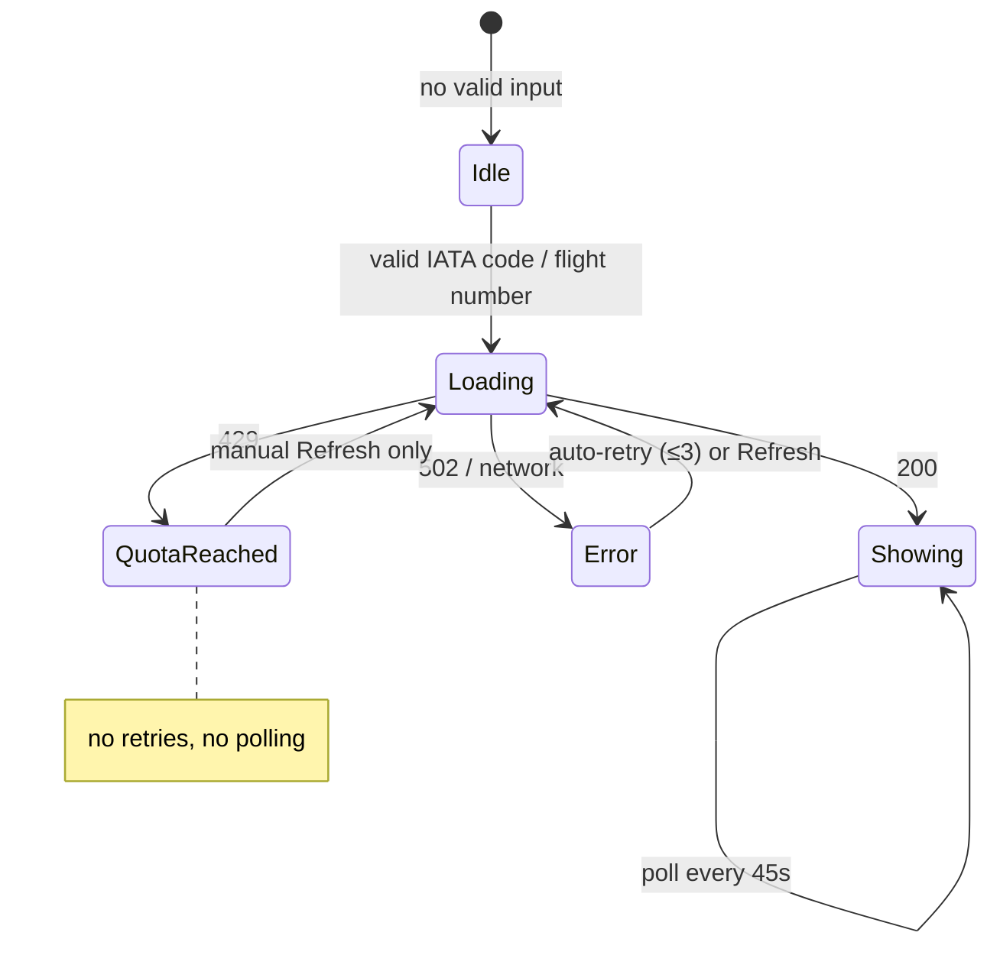
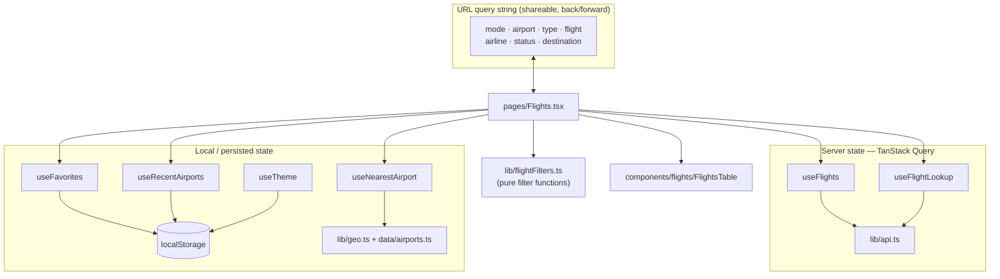
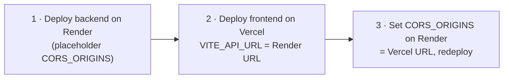

# LiveFlightWatch

A universal flight tracker — live departures and arrivals for any airport worldwide, plus lookup by flight number. No waiting on the slow board at the gate.

**Live:** [live-flight-watch.vercel.app](https://live-flight-watch.vercel.app)

```
┌──────────────────────────────────────────────────────────────────────────────┐
│ ✈ LiveFlightWatch        Flights   About   Contact           ☾   ★ Favorites │
├──────────────────────────────────────────────────────────────────────────────┤
│  [ By airport ] [ By flight # ]                                              │
│  Airport: [ JFK ]  📍 Use my location     ( Departures | Arrivals )   ☆ Save  │
│  Recent: LHR · SFO · ORD                                                     │
│  Airline: [ All ▾ ]   Status: [ All ▾ ]   Destination: [ london      ]       │
│                                                   Updated 12s ago  ⟳ Refresh  │
│ ┌──────────┬─────────────────┬──────────────┬───────┬──────┬──────┬─────────┐ │
│ │ Flight   │ Airline         │ Destination  │ Sched │ Est  │ Gate │ Status  │ │
│ ├──────────┼─────────────────┼──────────────┼───────┼──────┼──────┼─────────┤ │
│ │ BA112    │ British Airways │ LHR London   │ 18:30 │18:52 │ B24  │ delayed │ │
│ │ VS4      │ Virgin Atlantic │ LHR London   │ 19:10 │19:10 │ B31  │ sched.  │ │
│ └──────────┴─────────────────┴──────────────┴───────┴──────┴──────┴─────────┘ │
└──────────────────────────────────────────────────────────────────────────────┘
   URL: /?airport=JFK&destination=london   ← every filter lives in the URL
```

*(Illustrative sketch of the Flights page. On mobile the table becomes a stack of cards.)*

## Contents

- [Features](#features)
- [Quick start](#quick-start)
- [Architecture](#architecture)
  - [System overview](#system-overview)
  - [Lifecycle of a search](#lifecycle-of-a-search)
  - [Backend: provider-adapter layers](#backend-provider-adapter-layers)
  - [Caching](#caching)
  - [Error handling and the rate-limit state](#error-handling-and-the-rate-limit-state)
  - [Frontend: where state lives](#frontend-where-state-lives)
- [API reference](#api-reference)
- [Project structure](#project-structure)
- [Testing and CI](#testing-and-ci)
- [Deployment](#deployment)
- [Extending the project](#extending-the-project)

## Features

- Live departures/arrivals for any airport by IATA code (e.g. `JFK`, `LHR`)
- Flight number lookup (e.g. `AA100`) as an alternative search mode
- Filter results by airline, status and destination (code, airport name or city)
- "Use my location" picks the nearest airport via browser geolocation
- Favorites — save a search and jump back to it from the Favorites page
- Recently searched airports for quick re-access
- Auto-refresh every 45 seconds while a search is open
- Light/dark mode
- Desktop table + mobile card layout
- Searches are shareable via URL (filters sync to query params) and support browser back/forward
- Graceful handling of the flight-data provider's rate limit (a "quota reached" state instead of a generic error, with polling paused until it clears)

## Tech stack

| Layer    | Tools |
|----------|-------|
| Backend  | Python, FastAPI, httpx (async), Pydantic / pydantic-settings |
| Frontend | React 19, TypeScript, Vite, Tailwind CSS v4, TanStack Query, React Router |
| Data     | [AviationStack](https://aviationstack.com/) flights API (free tier) |
| Testing  | pytest (backend), Vitest + React Testing Library (frontend) |
| Hosting  | Render (backend, Docker), Vercel (frontend + Web Analytics) |
| CI       | GitHub Actions (`.github/workflows/ci.yml`) |

## Quick start

You need Python 3, Node.js, and a free API key from [aviationstack.com](https://aviationstack.com/).

**1. Backend** (terminal 1)

```bash
cd backend
python -m venv .venv && source .venv/bin/activate   # .venv\Scripts\activate on Windows
pip install -r requirements.txt
cp .env.example .env      # then set AVIATIONSTACK_API_KEY
uvicorn app.main:app --reload --port 8000
```

Interactive API docs: <http://localhost:8000/docs>

**2. Frontend** (terminal 2)

```bash
cd frontend
npm install
cp .env.example .env      # VITE_API_URL defaults to http://localhost:8000
npm run dev
```

Open <http://localhost:5173> and search for `JFK`.

### Configuration

| Variable | Where | Default | Purpose |
|----------|-------|---------|---------|
| `AVIATIONSTACK_API_KEY` | backend | — (required) | Upstream API key |
| `AVIATIONSTACK_BASE_URL` | backend | `https://api.aviationstack.com/v1/flights` | Upstream endpoint |
| `CACHE_TTL_SECONDS` | backend | `300` | How long a result is reused before refetching upstream |
| `CORS_ORIGINS` | backend | `http://localhost:5173` | Comma-separated list of allowed frontend origins |
| `VITE_API_URL` | frontend | `http://localhost:8000` | Where the frontend sends API calls |

> **Watch your quota.** The AviationStack free tier has a small monthly request limit. The backend cache and the 45s poll interval keep usage down, but leaving many tabs open on different airports will still burn through it.

## Architecture

### System overview

The browser never talks to AviationStack directly. The FastAPI backend holds the API key, normalizes the upstream data into a clean `Flight` shape, and caches results so repeated searches don't cost quota.



### Lifecycle of a search

What happens when someone types `JFK` into the airport box:



Airline, status and destination filters are applied **in the browser** (`lib/flightFilters.ts`) on the already-fetched list. Changing them never triggers a new API call.

### Backend: provider-adapter layers

The request path is `routers/flights.py` → `services/flight_service.py` → `providers/*`. Each layer knows only about the one below it through a narrow interface.



| Layer | File | Responsibility |
|-------|------|----------------|
| Router | `backend/app/routers/flights.py` | Validates query params, wires up the service (`get_flight_service`, built once via `lru_cache`), turns provider exceptions into HTTP status codes |
| Service | `backend/app/services/flight_service.py` | Cache lookup → provider call → cache write; stamps `fetched_at` and `cached` on the response |
| Provider interface | `backend/app/providers/base.py` | `FlightProvider` ABC plus `ProviderError` / `RateLimitError` |
| Provider implementation | `backend/app/providers/aviationstack.py` | Calls AviationStack and normalizes its payload |
| Models | `backend/app/models/flight.py` | Pydantic `Flight`, `FlightsResponse`, `FlightLookupResponse` (mirrored in `frontend/src/types/flight.ts`) |
| Cache | `backend/app/core/cache.py` | Generic in-process TTL cache |

**What normalization does** (`AviationStackProvider._to_flight`):

- Picks the departure leg for departures and the arrival leg for arrivals, so `terminal`, `gate` and times refer to *your* airport. Flight-number lookups always use the departure leg.
- Marks a `scheduled`/`active` flight as **`delayed`** when its leg delay is over 15 minutes.
- Maps unknown upstream statuses (e.g. `incident`) to `unknown`.
- Replaces AviationStack's placeholder strings (`"empty"`, `"N/A"`, `"unknown"`, …) with `null`.

### Caching

- Key format: `"{AIRPORT}:{type}"` (e.g. `JFK:departures`) or `"lookup:{FLIGHT}"` (e.g. `lookup:AA100`).
- Default TTL: 300 s. Combined with the frontend's 45 s poll, the UI may show data up to ~5 minutes old. The `cached` flag in each response tells you whether that call reached upstream.
- The cache is **in-process and per-worker**. With several uvicorn workers, each one has its own cache, so hit rates drop and quota usage rises. A shared cache (e.g. Redis) would be needed to scale out.

```
t=0s    GET JFK:departures  → miss → AviationStack → cached=false
t=45s   GET JFK:departures  → hit                  → cached=true
t=90s   GET JFK:departures  → hit                  → cached=true
 ...
t=315s  GET JFK:departures  → expired → AviationStack → cached=false
```

### Error handling and the rate-limit state

Providers never leak raw upstream HTTP details. They raise one of two exceptions, and the router maps them to status codes:

| Upstream situation | Provider raises | API returns | Frontend shows |
|--------------------|-----------------|-------------|----------------|
| HTTP 429, or error code `usage_limit_reached` / `rate_limit_reached` | `RateLimitError` | `429` | "Quota reached" state; retries **and** polling stop |
| Network error, non-200, non-JSON, missing `data`, other API error | `ProviderError` | `502` | Generic error with retry (up to 3 automatic retries) |
| Invalid airport code / flight number | — (FastAPI validation) | `422` | Query not sent (frontend validates with the same patterns first) |

The 429 path is deliberately separate. Retrying an exhausted quota only wastes requests, so `useFlights` and `useFlightLookup` switch off both `retry` and `refetchInterval` when they see a 429:



If you change these hooks or their error handling, keep this distinction intact.

### Frontend: where state lives



| Kind of state | Owner | Why |
|---------------|-------|-----|
| Flight data | TanStack Query (`hooks/useFlights.ts`, `hooks/useFlightLookup.ts`) | Caching, polling, retries and loading states for free |
| Search filters | URL query params, read with `useSearchParams` in `pages/Flights.tsx` | Shareable links; back/forward undoes one filter change at a time. Typing uses `replace` so keystrokes don't flood history; dropdowns and buttons use `push`. |
| Filtering logic | `lib/flightFilters.ts` | Pure functions, separate from fetching, easy to unit test |
| Favorites, recent airports | `hooks/useFavorites.ts`, `hooks/useRecentAirports.ts` → localStorage (`lfw:favorites`, `lfw:recent-airports`) | Per-device, no accounts needed |
| Theme | `hooks/useTheme.ts` → localStorage (`theme`) | Light/dark preference |
| Nearest airport | `hooks/useNearestAirport.ts` + `lib/geo.ts` against the curated list in `data/airports.ts` | Runs once on first load if no airport is in the URL, or on "Use my location" |

**Example shareable URLs**

| URL | Shows |
|-----|-------|
| `/?airport=LHR` | Heathrow departures |
| `/?airport=LHR&type=arrivals&status=delayed` | Delayed arrivals into Heathrow |
| `/?airport=JFK&airline=Delta%20Air%20Lines&destination=los` | Delta departures from JFK to destinations matching "los" |
| `/?mode=flight&flight=AA100` | Flight-number lookup for AA100 |

Pages: `/` and `/flights` (Flights), `/favorites`, `/about`, `/contact`.

## API reference

### `GET /api/flights`

| Param | Required | Format | Default |
|-------|----------|--------|---------|
| `airport` | yes | 3-letter IATA code (case-insensitive) | — |
| `type` | no | `departures` \| `arrivals` | `departures` |

```bash
curl "http://localhost:8000/api/flights?airport=jfk&type=departures"
```

```json
{
  "airport": "JFK",
  "type": "departures",
  "fetched_at": "2026-11-23T18:04:12.511Z",
  "cached": false,
  "flights": [
    {
      "flight_number": "BA112",
      "airline": "British Airways",
      "origin": { "iata": "JFK", "name": "John F Kennedy International" },
      "destination": { "iata": "LHR", "name": "Heathrow" },
      "scheduled_time": "2026-11-23T18:30:00+00:00",
      "estimated_time": "2026-11-23T18:52:00+00:00",
      "actual_time": null,
      "status": "delayed",
      "terminal": "7",
      "gate": "B24"
    }
  ]
}
```

### `GET /api/flights/lookup`

| Param | Required | Format |
|-------|----------|--------|
| `flight_number` | yes | 2–3 letter airline code + 1–4 digits + optional letter, e.g. `AA100`, `DL2042` |

```bash
curl "http://localhost:8000/api/flights/lookup?flight_number=AA100"
```

Returns `{ "flight_number", "fetched_at", "cached", "flights": [...] }`. `flights` can contain several entries (e.g. the same flight number on different days or legs).

`flight.status` is one of `scheduled`, `active`, `landed`, `cancelled`, `diverted`, `delayed`, `unknown`.

**Errors (both endpoints):** `422` invalid params · `429` upstream quota or rate limit · `502` any other upstream failure. Error bodies look like `{ "detail": "..." }`.

## Project structure

```
backend/
  app/
    main.py            FastAPI app + CORS
    config.py          Settings from env / .env
    routers/           HTTP layer: validation, error → status mapping
    services/          FlightService: cache-then-provider orchestration
    providers/         FlightProvider interface + AviationStack adapter
    models/            Pydantic response schemas
    core/              TTL cache
  tests/               pytest suites, one per layer
  conftest.py          sets a dummy API key so Settings() works in tests
  Dockerfile           used by Render
frontend/
  src/
    pages/             Flights (home), Favorites, About, Contact
    components/        FlightsTable, skeleton loader, theme toggle, navbar
    hooks/             useFlights, useFlightLookup, useFavorites, useRecentAirports, useTheme, useNearestAirport
    lib/               API client, flight filters, geo helpers
    data/airports.ts   curated airport list (coords + city) for geolocation and city search
    types/flight.ts    TS mirror of the backend models
render.yaml            Render Blueprint for the backend
.github/workflows/     CI
```

## Testing and CI

```bash
cd backend && pytest -v
cd frontend && npm run test       # or npm run test:watch
cd frontend && npm run lint && npm run build
```

CI runs all four (backend tests, frontend tests, lint, build) on every push to `main` and every PR, so run `npm run build` locally before pushing.

Notes:
- `backend/conftest.py` sets a dummy `AVIATIONSTACK_API_KEY` before anything imports `app.config`. New backend tests that import the app depend on it.
- `vitest.config.ts` is separate from `vite.config.ts` so the production `tsc -b` never type-checks test-only config.

## Deployment

Deploy the backend first, since the frontend needs its live URL. Recommended: Render (backend) + Vercel (frontend), both free tier.



### Backend (Render)

1. On [render.com](https://render.com), **New > Blueprint**, connect this GitHub repo. Render reads `render.yaml` at the repo root and configures the service automatically.
2. When prompted for env vars, set:
   - `AVIATIONSTACK_API_KEY`: your key from [aviationstack.com](https://aviationstack.com/).
   - `CORS_ORIGINS`: a placeholder for now (e.g. `http://localhost:5173`). You'll update it once the frontend URL exists.
3. Deploy, then copy the resulting service URL (e.g. `https://liveflightwatch-backend.onrender.com`).
4. Render's free tier spins the service down after ~15 minutes idle. The first request after that takes 30–60 s to cold-start, and the in-memory cache starts empty.

Without a Blueprint, create the service manually as a **Web Service** with runtime "Docker", root directory `backend`, and the same env vars.

### Frontend (Vercel)

1. On [vercel.com](https://vercel.com), **New Project**, import this repo.
2. Set **Root Directory** to `frontend` (this is a monorepo).
3. The framework preset should auto-detect as Vite (`npm run build`, output `dist/`).
4. Add environment variable `VITE_API_URL` = the Render backend URL.
5. Deploy, then copy the frontend URL (e.g. `https://liveflightwatch.vercel.app`).
6. Back on Render, set `CORS_ORIGINS` to that frontend URL and redeploy the backend.

`frontend/vercel.json` rewrites all paths to `index.html` so client-side routes like `/favorites` work on refresh.

## Extending the project

**Swap or add a data provider.** Write a class that implements `FlightProvider` (`get_flights`, `get_flight_by_number`), returns `list[Flight]`, and raises `RateLimitError` / `ProviderError` on failure. Then build it in `get_flight_service()` in `routers/flights.py`. The service, routers and frontend need no changes.

```python
class MyProvider(FlightProvider):
    async def get_flights(self, airport: str, flight_type: FlightType) -> list[Flight]:
        ...  # call upstream, map to Flight, raise RateLimitError / ProviderError

    async def get_flight_by_number(self, flight_number: str) -> list[Flight]:
        ...
```

**Add a field to `Flight`.** Update `backend/app/models/flight.py`, map it in the provider's `_to_flight`, mirror it in `frontend/src/types/flight.ts`, then render it in `FlightsTable`.

**Add a filter.** Add a pure function to `lib/flightFilters.ts` (with a test), a query param plus setter in `pages/Flights.tsx`, and, if it should be saveable, a field on `Favorite` in `hooks/useFavorites.ts`.

## License

See [LICENSE](LICENSE).
